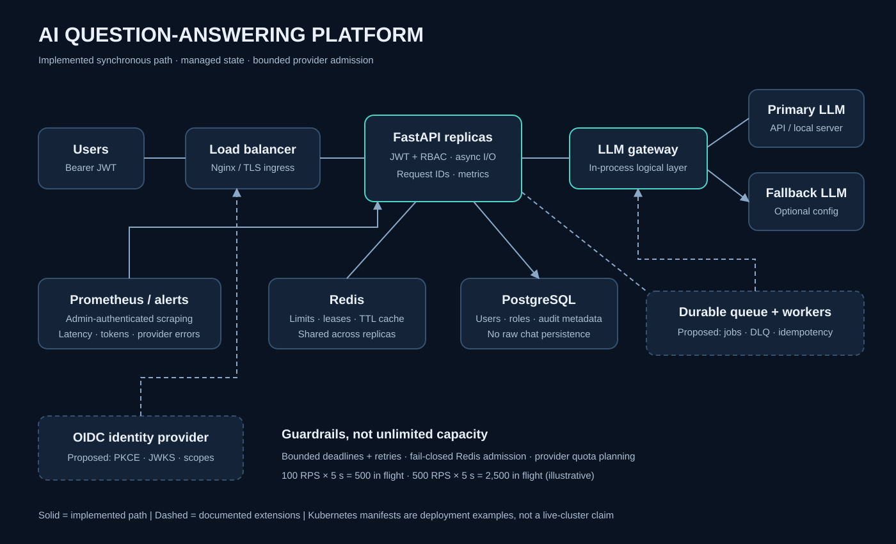

# AI Question-Answering Platform

A production-oriented implementation of the **AI/LLM Platform & DevOps Engineer** assessment: authenticated FastAPI question answering, a bounded OpenAI-compatible LLM gateway, Redis coordination, PostgreSQL audit persistence, Prometheus instrumentation, and container deployment.

**Submission guide:** [requirement coverage](docs/assessment-coverage.md) · [architecture and migration](docs/architecture.md) · [operations runbook](docs/runbook.md) · [verification evidence](docs/verification.md) · [4-minute narrated walkthrough](docs/walkthrough.mp4).



## Scope and status

This is source code and deployment configuration, not a hosted service. No real API keys are bundled. The walkthrough is AI-narrated and explicitly labeled, not the submitter's own voice or a claim of a live deployment. Review it and personalize your explanation before submission. The verification report distinguishes **executed local Docker/PostgreSQL/Redis/real-Gemini checks** from unexecuted Kubernetes and load tests. The documented 100–500 RPS design is a capacity discussion, not a benchmark certification.

Implemented:

- JWT login with password hashes, expiry/issuer/audience verification, persisted roles and authorization.
- User/admin chat and admin-only metrics. Read-only users cannot invoke paid generation.
- Async OpenAI-compatible HTTP requests, bounded retry/backoff, total deadline, optional fallback.
- Shared Redis rate limits and concurrency leases; fail-closed admission on Redis failure.
- Optional user-isolated TTL response cache, disabled by default.
- PostgreSQL users and chat audit metadata. Raw prompts/answers are not persisted by default.
- Correlation IDs, sanitized errors, low-cardinality Prometheus metrics, readiness/liveness.
- Release-time schema migration, non-root container, scale-ready Compose, Kubernetes examples and CI.

Documented but **not implemented**: enterprise OIDC, predictive distributed provider RPM/TPM reservations, durable asynchronous jobs, RAG, streaming, administrative CRUD UI, and exactly-once billing/idempotency.

## Prerequisites

- Docker Engine with Docker Compose v2 for the full stack.
- A valid key for an OpenAI-compatible provider, or a local model server exposing `/v1/chat/completions`.
- Python 3.12+ for local development. Use a separate virtual environment, never a system/Hermes interpreter environment.
- For a production deployment: TLS ingress, private managed data services, runtime secrets, quota budgets, monitoring and tested recovery procedures.

## Quick start

The deployment helpers and exact configuration are described in `deploy/`. Start by running `python3 scripts/setup_env.py` to generate `.env` with unique secrets, then set your provider key before launching. Keep `.env` untracked. Do not paste secrets into shell history or commit them.

```bash
python3 scripts/setup_env.py
# Edit the generated .env: set your provider key and desired model.
# The helper creates independent random JWT/database/Redis secrets, mode 0600.
docker compose up --build -d
# The one-shot migration service must complete successfully before API startup.
docker compose ps
curl --fail http://localhost:8080/health
```

Create an account using the CLI; it prompts for a password instead of baking in credentials:

```bash
docker compose exec api python -m app.cli create-user --username admin --role admin
docker compose exec api python -m app.cli create-user --username analyst --role user
```

Only use a strong unique password. `BOOTSTRAP_PASSWORD` is available for controlled noninteractive provisioning; inject it through your secret system rather than a literal shell command. No demo admin account is created automatically.

### Gemini configuration used for the full-stack check

Set `LLM_API_KEY` privately in your generated `.env`; the archive never contains the test key. The non-secret settings used on November 22, 2026 were:

```dotenv
LLM_BASE_URL=https://generativelanguage.googleapis.com/v1beta/openai
LLM_MODEL=gemini-3.8-flash
LLM_FALLBACK_MODEL=gemini-3.5-flash
```

Gemini 3.8 Flash returned provider-side `503 UNAVAILABLE` (high demand) during verification. The bounded primary/fallback path returned an actual answer from 3.5 Flash. The response reports the **actual model used**; this is not evidence of successful 3.8 inference. Availability and account quotas can change. Fallback uses the primary base URL/key unless independently configured.

Caching remains **off by default**. The synthetic cache check temporarily set `CACHE_TTL_SECONDS=120`; enabling it stores response content in Redis for that TTL even when PostgreSQL raw-content persistence is disabled.

### Call the API

Login accepts JSON, not an OAuth password-form submission:

```http
POST /auth/login
Content-Type: application/json

{"username": "analyst", "password": "<your locally provisioned password>"}
```

Use the returned `access_token` in the next request:

```http
POST /chat
Authorization: Bearer <access_token>
Content-Type: application/json

{"question": "Explain horizontal scaling in two sentences."}
```

The response includes the answer, provider/model information, measured timing, cache status, and token usage. Inspect the running `/docs` OpenAPI page for exact response fields. Login/validation errors do not expose whether a password hash exists. Treat access tokens as secrets; they are intentionally not put in example source files.

```http
GET /metrics
Authorization: Bearer <admin-access-token>
```

Login throttling uses the direct peer IP. In the default Compose setup Uvicorn does not trust forwarded headers, so clients behind Nginx share a login bucket (10 requests/minute by default). For public traffic, use an edge login limiter and configure Uvicorn to trust only your actual proxy IPs/CIDRs (`--proxy-headers --forwarded-allow-ips=<trusted-proxy-range>`); never trust arbitrary forwarded headers on a publicly reachable API. Keep the backend private. The chat limiter is independently user-scoped.

The health endpoints do not invoke the paid LLM API. Readiness is dependency-aware; liveness distinguishes a running process from healthy dependencies.

### Scale locally

```bash
docker compose up -d --scale api=3
```

Nginx distributes requests among API instances. Redis admission state and PostgreSQL identity/audit state are shared. A provider concurrency cap applies across replicas, not independently to each worker. Local scaling does not raise provider quota.

### Configuration

See `.env.example` and application settings for the authoritative list. Key controls:

| Setting | Meaning |
| --- | --- |
| `DATABASE_URL` | Async SQLAlchemy PostgreSQL DSN; credentials must be URL-encoded |
| `REDIS_URL` | Shared admission/cache Redis DSN |
| `JWT_SECRET` | Strong random signing secret, at least 32 characters |
| `JWT_ISSUER`, `JWT_AUDIENCE` | Expected token claims |
| `LLM_BASE_URL`, `LLM_API_KEY`, `LLM_MODEL` | OpenAI-compatible upstream |
| `LLM_FALLBACK_MODEL` | Optional fallback; no default fallback is silently invented |
| `LLM_FALLBACK_BASE_URL`, `LLM_FALLBACK_API_KEY` | Optional independent fallback endpoint/credential |
| `LLM_TIMEOUT_SECONDS` | Bound for an upstream attempt |
| `LLM_TOTAL_TIMEOUT_SECONDS` | Overall gateway operation budget including retry/fallback |
| `LLM_MAX_RETRIES` | Bounded retries for transient failures |
| `LLM_MAX_CONCURRENCY` | Shared concurrent provider-operation cap |
| `RATE_LIMIT_REQUESTS`, `RATE_LIMIT_WINDOW_SECONDS` | Per-user shared admission window |
| `CACHE_TTL_SECONDS` | Zero disables response caching; positive values store answers briefly in Redis |
| `APP_ENV` | Application environment, including stricter production settings |

A local model server must implement the expected chat-completion schema. Provider-specific SDK features and automatic endpoint compatibility are not guaranteed. An empty/wrong credential is an error, not a reason to fabricate a generated answer.

## Local development and tests

```bash
python3.12 -m venv .venv
. .venv/bin/activate
python -m pip install -r requirements-dev.txt
python -m pytest -q
```

Tests use isolated fixtures and do not spend money on an LLM provider. Real Redis integration checks are available as documented by the test fixtures. `tools/provider_fixture.py` is an explicitly fake loopback HTTP provider for end-to-end transport testing; it is never enabled by the application as a fallback.

To develop outside containers, set environment variables for your PostgreSQL and Redis services, run `python -m app.cli migrate`, provision a user, and run:

```bash
uvicorn app.main:app --host 127.0.0.1 --port 8000
```

## Deployment and monitoring

See `deploy/k8s/README.md` for managed PostgreSQL/Redis prerequisites, generated Secrets, migration ordering, HPA limitations, ingress and network policy. These manifests require environment-specific image, hostname, identity, secret, and egress configuration; they are not a blind `kubectl apply` production promise.

Prometheus scraping must authenticate as an administrator in this assessment. Token metrics expose `type="prompt_tokens"`, `type="completion_tokens"`, and `type="total_tokens"`. Use `sum(rate(aiqa_llm_tokens_total{type="total_tokens"}[5m]))` for aggregate provider consumption; **do not sum across all three types**, which would double-count components. The provider-reported total can include reasoning tokens absent from visible completion counts. Cache hits do not increment token consumption.

The optional monitoring profile expects a protected bearer-token file. Tokens expire: refresh them through `scripts/refresh_metrics_token.py --username metrics-reader --watch`, supervise that process, or introduce a narrow workload identity before production. Do not expose `/metrics` anonymously as a workaround. Example alerts need real alert routing/paging configuration.

## Architecture questions

The [architecture document](docs/architecture.md) covers:

- 100 RPS sustained / 500 RPS bursts, illustrative concurrency/token budgets, HPA and provider quota constraints.
- Redis's different roles in cache, admission, and leases.
- A proposed durable queue for long jobs and why detached background tasks are insufficient.
- Failure recovery, deadlines, fallback, billing ambiguity, and bounded graceful degradation.
- SSO/OIDC transition and granular RBAC permissions.
- Migration from one EC2 server / ten users to a highly available 10,000-user service, including data compatibility, canary cutover, rollback, secrets, and trade-offs.

## Walkthrough

`docs/walkthrough.mp4` is a roughly 4-minute AI-narrated six-slide explanation. `docs/walkthrough.md` is editable narration and `docs/narration.txt` is the plain text. To regenerate, use a separate media virtual environment with Pillow and edge-tts, plus system ffmpeg/ffprobe, then run `python tools/render_walkthrough.py --tts`. Edge TTS sends only the public narration text to its synthesis service. A personal screen recording can instead demonstrate actual startup, login, chat, metrics, and test results using the script as a guide.

## Publication

The delivered archive includes source and a portable Git bundle. Create a private or public repository under your own account, review all files and secret exclusions, then push using your own authenticated Git remote. No repository was published and no assessment form submitted without your direction. Review the implementation so you can explain its design and limitations in the interview.
