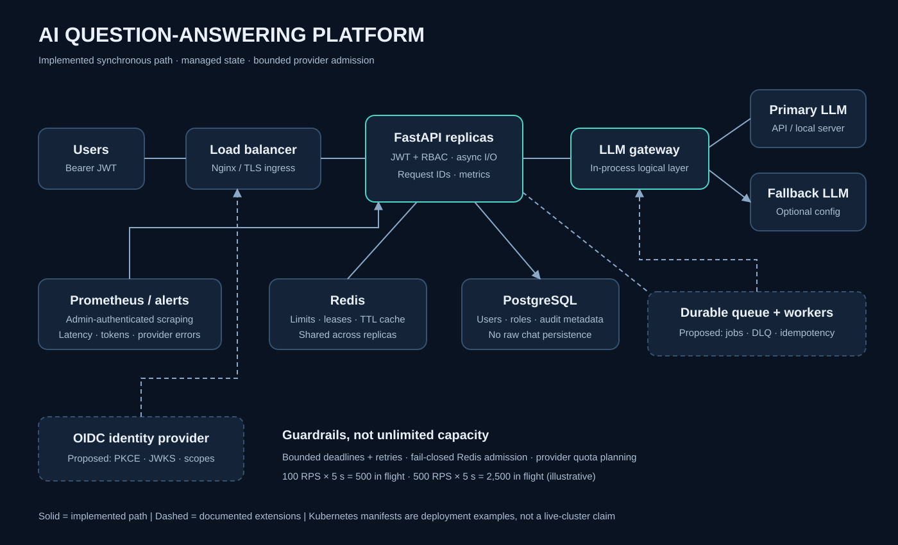
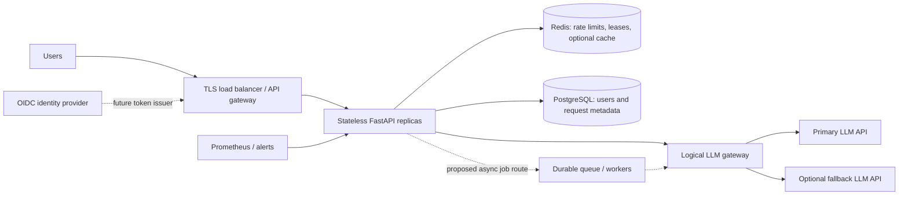

# Architecture, scaling, and migration

## What is implemented versus proposed

The submission implements a synchronous question-answer API with a lightweight in-process LLM gateway, PostgreSQL, and Redis. Compose deploys API replicas behind Nginx. The Kubernetes manifests are a starting point for a managed production environment, not evidence of a deployed cluster. Queued inference, external SSO, a separate LLM gateway, and custom-metric autoscaling are deliberate **future extensions**, not features silently claimed as complete. There is no RAG/vector database because the assessment does not supply a retrieval corpus; adding one would increase operational cost without serving the stated task.

The gateway is a logical boundary inside the API today: provider authentication, timeouts, retry classification, fallback, and token accounting are centralized. It can be extracted or replaced with LiteLLM when multiple teams/providers, centralized budgets, or tenant routing justify another service. Existing FastAPI security components, SQLAlchemy, Redis, and Prometheus libraries are used rather than inventing protocols. External gateways introduce their own failure domain and secret-management surface.

## State and failure boundaries

- API instances hold no durable sessions. JWTs let any healthy replica handle a request. A DB lookup keeps role/disabled-user checks tied to current persisted identity state.
- PostgreSQL stores users and chat audit metadata. Keep pooled connections bounded across all replicas; use PgBouncer when the aggregate pool would approach database limits. Do not raise replica count without budgeting connections.
- Redis coordinates cross-replica rate limits and expiring concurrency leases; a semaphore in one Python process alone cannot enforce a global provider cap. Cache is opt-in and scoped to the authenticated user; avoid shared-user answer leakage. Cache invalidation must include model and generation policy.
- Prompts and answers are not persistently stored by default. Opting into answer caching places content in Redis for its TTL; treat Redis backups, access control, and retention accordingly. Do not log bearer tokens, passwords, prompts, or upstream API keys.
- Redis unavailability fails admission closed rather than letting every replica overwhelm the provider. PostgreSQL readiness failure removes the instance from normal traffic. An audit-write failure after an upstream response must be reported explicitly rather than claiming a durable record exists.
- A lease expiry recovers admission capacity after a crashed process. Its duration must exceed the bounded provider operation deadline, and cancellation must release leases. Leases are a guardrail, not a replacement for provider RPM/TPM quotas.
- Retry only transient failures with bounded exponential backoff and jitter. The total operation deadline bounds retry and fallback latency. When fallback is configured, the primary receives at most half the remaining budget; the fallback receives the remainder, so a stalled primary cannot consume the entire deadline. Timeouts, connection-establishment errors, HTTP 429 and 5xx are transient; other protocol errors and permanent rejections fail without blind retries. Rejected credentials or malformed requests should not be retried. A fallback is separately configured; a second model on the same account does not necessarily provide quota independence.
- A Redis lease-release error is logged without replacing completed work; the TTL recovers the lease. Admission still fails closed while Redis is unavailable.
- Retrying a POST can duplicate generation and billing if the first response was lost. This assessment does not claim exactly-once generation. Add a per-user idempotency key and durable pending/completed state if clients will retry automatically.

## 100 requests/second, bursts to 500

A registered population of 10,000 is not 10,000 simultaneous generations. Measure active users, arrival rate, output length, and latency before sizing. By Little's law, at an average provider latency of 5 seconds, **100 RPS implies about 500 in-flight calls**, and **500 RPS implies about 2,500**. If each uncached request uses 1,000 combined tokens, those rates imply roughly **6 million and 30 million tokens/minute**, before retries. These are illustrative capacity calculations, not benchmark results or provider quotas.

A safe rollout starts with explicit budgets, not a promise that more API pods create LLM capacity:

1. Obtain provider RPM, TPM, concurrent-call limits, budget limits, and fallback capacity. Account for each retry as another possible provider request. If a provider allows 3,000 RPM, sustained uncached admission cannot exceed approximately 50 RPS regardless of pod count, and TPM may impose a lower ceiling.
2. Define a p95 latency SLO, error budget, and maximum spend. Load test a local provider simulator first, then run a controlled real-provider test within an approved quota. Separate API overhead from time spent awaiting generation.
3. Run at least two stateless API replicas across failure zones, with readiness probes, rolling updates, a disruption budget, and an ingress/load balancer. Each process uses async I/O and a bounded connection pool. Horizontal scaling improves HTTP capacity, not upstream supply.
4. Use shared per-user rate limits and a shared provider concurrency cap. The implementation supplies those two controls. **It does not implement a predictive distributed TPM/RPM budget.** Add atomic token reservation using input token estimates plus max output tokens, then reconcile with actual usage; maintain separate provider/model quota buckets. Return 429 with Retry-After instead of unbounded queueing.
5. HPA CPU is a baseline in the example manifests. LLM workloads are often waiting on network I/O, so CPU alone can miss saturation. Add autoscaling on in-flight work and queue age through a metrics adapter, and keep replica ceilings aligned with Redis/provider/database budgets. A minimum replica count avoids cold-start surprises.
6. Use optional TTL caching only where repeat questions and privacy policy justify it. It is not a substitute for capacity planning. A future single-flight lock can reduce cache stampedes; it is not claimed as implemented.
7. For long workloads add POST /jobs returning 202 and a job ID, a durable SQS/RabbitMQ queue, and workers with visibility timeouts, bounded retries, dead-letter queues, per-user ownership, cancellation, retention, and idempotency. Do not simply spawn detached tasks inside an API worker: process restarts lose them. A bounded queue and maximum wait age prevent infinite latency. Keep interactive chat on the synchronous route.

The provided default concurrency of 20 is intentionally conservative. It is **not** a 500 RPS configuration. If the system is saturated, reject/defer work predictably rather than exhausting sockets, memory, or budget. GPU hosting is a different trade-off: it removes external quota dependence but adds model serving, GPU scheduling, memory, and capacity responsibilities.

## SSO/OIDC and RBAC

Current implementation: local username/password login, Argon2 password hashes, short-lived signed JWTs with issuer/audience/expiry validation, and role checks. Admin can chat and read metrics; user can chat; read-only cannot invoke paid generation or access admin metrics. Health endpoints expose only minimal operational status. Local CLI provisions accounts; there is no public self-registration or administrative CRUD API. Administrative user/configuration UI and read-only reporting routes would be additional endpoints, not implied capabilities of the role names.

Production flow:

`Application → OIDC authorization-code + PKCE → identity provider → access JWT → API gateway → AI API`

The browser/client signs in with an IdP such as Keycloak or the organization's existing IdP. The API must validate an **access token** intended for this API, never an ID token. Use asymmetric JWT verification with an explicit algorithm allowlist and cached JWKS, bounded refresh, issuer and audience checks, expiry/nbf validation, and key rotation. Do not trust a caller-supplied role header. Map verified groups/scopes to server-side permissions such as `chat:invoke`, `metrics:read`, `users:manage`, and `reports:read`. Enforce authorization again in the service even if the gateway checks it. Handle tenant boundaries, provisioning/deprovisioning, and audit events. For immediate revocation use short TTLs plus a revocation/version check or introspection as appropriate. Production transport requires TLS and browser token-storage/CSRF/XSS analysis appropriate to the chosen client.

Metrics scraping currently uses the same short-lived admin JWT mechanism. The optional monitoring profile therefore needs a protected token file and refresh before expiry; the provided helper refreshes on demand or periodically in supervised watch mode. In production, use workload identity or a narrow `metrics:read` machine principal and automate refresh. Do not silently make metrics public to simplify scraping.

## Migration: single EC2 / 10 users to a 10,000-user platform

### Stage 1 — observe and make the current workload reproducible

Instrument request latency, provider latency/error rates, inflight calls, tokens, cache hits, DB pools, CPU/memory, and restarts. Establish real baseline traffic and failure modes. Inventory local state, background tasks, secrets, file uploads, sessions, and database schema. Define recovery-time and recovery-point objectives. Containerize the same application and add health/readiness checks, CI, and reproducible configuration before changing every dependency at once.

### Stage 2 — move state out, then introduce replicas

Provision managed PostgreSQL with encrypted storage, backups/PITR, tested restores, and a failover plan; provision managed Redis with private networking, authentication, TLS, and appropriate availability. Move local uploads to object storage. Migrate user/password data and audit history using a backward-compatible schema change, validated row counts/checksums, and managed replication where available. Use an **expand → deploy compatible readers/writers → backfill → switch → contract** sequence. Run schema migrations once as a release job, never independently in every starting replica.

For SQLite-to-PostgreSQL, replication is not automatically available. Use a rehearsed export/import and a short write freeze, or engineer and verify change capture/dual-write reconciliation. Do not promise zero downtime without a proven data synchronization mechanism. Keep the old application/schema compatible for rollback. A traffic rollback is unsafe if the old database has become stale.

### Stage 3 — deploy privately and gradually cut over

Use managed ECS/Fargate if the team mainly needs reliable containers without Kubernetes operational overhead; choose managed Kubernetes when existing team capability, portability, policy, or workload diversity warrants it. The included Kubernetes sample illustrates the latter, not a mandate. Build immutable image tags/digests, scan dependencies, use a secret manager with workload identity, and restrict egress to the actual provider and data services.

Run smoke and integration checks in staging, exercise Redis/provider/DB outages and cancellation, and load test the quota-aware admission path. Deploy two replicas behind the ALB/ingress. Shift a small canary percentage to the new service; compare latency, errors, token spend, and data correctness to the old fleet. Increase traffic in steps with automatic rollback thresholds. Drain old connections during termination, keep graceful-shutdown time longer than the request deadline, and retain old capacity until the observation window passes. DNS changes alone are coarse due to caching; weighted target groups provide finer control.

### Stage 4 — operate and recover

Store nonsecret settings in config maps/environment and secrets in a managed secret store, injected only at runtime. Rotate provider/DB/JWT secrets; local HS256 rotation needs an overlap strategy or re-login, so prefer the IdP/JWKS path at scale. Redis failover can lose recent rate-limit/cache state: choose conservative restart behavior. DB restore exercises, queued-job replay tests, provider failover drills, runbooks, budgets, and paging ownership are part of readiness, not optional paperwork.

Alert on error-budget burn, p95 latency, elevated upstream 429/5xx, concurrency rejection, Redis errors, audit DB failures, and failed readiness. Monitor the monitoring path too: a JWT expiry or denied scrape can make application metrics disappear. Do not label metrics with usernames, prompt text, arbitrary URLs, request IDs, or unbounded model strings. Logs should carry correlation IDs so a user-visible failure can be traced without exposing content.

## Trade-offs and boundaries

- Synchronous API: easy to reason about, but holds a connection for provider latency; asynchronous jobs are preferable for very long work.
- Redis shared controls: inexpensive coordination but another availability dependency; fail-closed favors spend protection over availability.
- PostgreSQL audit writes: durable accountability costs a transaction and can block otherwise successful answers if storage is down.
- Local JWT: self-contained assessment setup, not a complete workforce identity lifecycle.
- No streaming in this submission: simpler total-deadline/error semantics; add SSE with cancellation/accounting before claiming streaming support.
- No proven 500 RPS, live Kubernetes deployment, paid provider invocation, or exactly-once billing is implied by unit tests.

## Primary references

Checked as design references while preparing the project; dependency versions are pinned in requirements files.

- FastAPI JWT tutorial: https://fastapi.tiangolo.com/tutorial/security/oauth2-jwt/
- LiteLLM gateway (considered for an extracted gateway): https://docs.litellm.ai/docs/
- Redis rate-limit patterns: https://redis.io/tutorials/howtos/ratelimiting/
- Redis Lua atomic execution: https://redis.io/docs/latest/develop/programmability/eval-intro/
- Kubernetes HPA: https://kubernetes.io/docs/tasks/run-application/horizontal-pod-autoscale/
- Kubernetes disruption budgets: https://kubernetes.io/docs/concepts/workloads/pods/disruptions/
- OpenAI error handling: https://platform.openai.com/docs/guides/error-codes/api-errors
- OpenAI rate limits: https://platform.openai.com/docs/guides/rate-limits
- Prometheus instrumentation guidance: https://prometheus.io/docs/practices/instrumentation/
- OIDC Core: https://openid.net/specs/openid-connect-core-1_0.html
